# Active Noise Control: LMS, NLMS, and FxLMS Simulation

A Python simulation exploring feedforward active noise control (ANC) by comparing three adaptive filtering algorithms: Least Mean Squares (LMS), Normalized Least Mean Squares (NLMS), and Filtered-x Least Mean Squares (FxLMS). The goal is to better understand how each algorithm adapts, how quickly it converges, how much noise it can reduce, and how changes in step size, filter length, and secondary-path delay affect its stability.

## Overview

Active noise control works by generating a signal that is approximately equal in amplitude but opposite in phase to an unwanted sound. When the original noise and the anti-noise meet acoustically, they can partially or completely cancel each other out. In a feedforward ANC system, a reference microphone picks up the noise before it reaches the listening position. That signal is processed by an adaptive FIR filter, and the resulting anti-noise signal is played through a loudspeaker. An error microphone measures the remaining sound so the filter can adjust its coefficients.

One important part of ANC is that the signal coming from the loudspeaker does not reach the error microphone instantly. It passes through what is called the secondary path, which includes the loudspeaker, acoustic environment, and microphone response. This makes ANC more complicated than simply inverting the incoming noise signal.

This simulation models the reference noise, the primary path from the noise source to the error microphone, three secondary path scenarios from the loudspeaker to the error microphone, and sensor noise at the error microphone with a 30 dB signal-to-noise ratio (SNR).All three algorithms operate within the same acoustic model.

## Signal Model

| Element | Value |
|---|---|
| Sample rate | 16 kHz, 1 second of signal |
| Noise | White Gaussian, reference variance 0.5 |
| Primary path | 6-tap FIR, 2-sample delay: [0, 0, 0.8, 0.4, 0.2, 0.1] |
| Secondary paths | No delay: [0.5, 0.3, 0.1]; 2-sample delay: [0, 0, 0.5, 0.3, 0.1]; 4-sample delay: [0, 0, 0, 0, 0.5, 0.3, 0.1] |
| Secondary path estimate | Exact copy of the secondary path |
| Error mic sensor noise | White, 30 dB below the noise at the mic |
| Controller length | 32 taps (baseline), 8 to 64 (sweep) |
| Random seed | 0 |

The paths are modeled as FIR filters, which is a useful way to represent the delays and amplitude changes that occur as sound travels through a system. The secondary path estimate is assumed to be perfect in each scenario. The reference signal, primary path, and sensor noise are held constant across scenarios. In a real ANC system, that path would normally have to be estimated, and errors in the estimate could affect how well the controller adapts.

**LMS (Least Mean Squares)**

LMS is an adaptive filtering algorithm that adjusts its filter coefficients based on the error between the desired signal and the current filter output. In this case, the algorithm uses the error microphone signal to determine how the filter should change, even though the controller output passes through the secondary path before reaching that microphone.

`w(n+1) = w(n) + μ * e(n) * x(n)`

Here, `w(n)` represents the filter coefficients, `μ` is the step size, `e(n)` is the error signal, and `x(n)` is the reference input vector.

The step size controls how aggressively the filter updates. A larger step size can make the algorithm converge faster, but it can also cause the coefficients to fluctuate more or become unstable. A smaller step size usually produces smoother adaptation but takes longer to converge.

One thing I learned from testing LMS is that the step size cannot be chosen independently of the input signal and filter length. A value that works well for one configuration may cause another configuration to diverge, especially when the secondary path introduces delay.

**NLMS (Normalized Least Mean Squares)**

NLMS works similarly to LMS, but it normalizes the update using the energy of the input signal. This helps prevent the algorithm from making excessively large updates when the reference signal has a high amplitude.
    
`w(n+1) = w(n) + μ * e(n) * x(n) / (x(n)'x(n) + eps)`

The small value eps prevents division by zero or a very small number.

The main advantage of NLMS is that its step size is less dependent on the input signal level and filter length. For the standard NLMS update without a secondary path, the usual theoretical step-size range is 0 < mu < 2. That bound does not directly describe the stability of this ANC system, where NLMS does not account for the secondary path.

This makes NLMS useful when the input level changes or when the same algorithm needs to work with different filter lengths.

**FxLMS (Filtered-x Least Mean Squares)**

FxLMS is designed specifically to account for the secondary path in an ANC system. This is an important difference from ordinary LMS because the controller output must pass through the loudspeaker and acoustic path before it affects the error microphone.

`e(n) = d(n) - s * (w'x)(n)`

where d(n) is the noise reaching the error microphone through the primary path, y(n) is the controller output, and s(n) represents the secondary path. The asterisk represents convolution.

Because the secondary path changes the signal before it reaches the error microphone, FxLMS filters the reference signal through an estimate of that path before using it to update the controller coefficients:

`w(n+1) = w(n) + μ * e(n) * x_f(n),    x_f(n) = s_hat * x(n)`

The filtered reference gives the algorithm a better representation of how changes to the controller output will affect the measured error.

My main takeaway from looking at FxLMS is that the controller has to account for the actual signal path between the loudspeaker and the error microphone. Simply applying regular LMS to the same setup would ignore an important part of the system and would not give the correct gradient for minimizing the acoustic error.

## Evaluation Method

LMS, NLMS, and FxLMS are now evaluated using the same feedforward ANC model. For every algorithm, the controller output passes through the true secondary path before reaching the error microphone. The difference is in how the weights are updated: LMS and NLMS use the unfiltered reference signal, while FxLMS uses a reference filtered through the estimated secondary path.

The simulation compares three secondary paths: `no_delay`, `delay_2`, and `delay_4`. The primary path has a 2-sample delay, so these scenarios allow me to examine how the timing of the anti-noise affects cancellation. Each scenario uses the same realization of reference noise and sensor noise, making it easier to isolate the impact of the secondary path.

Noise reduction is now calculated directly from the residual of the adaptive run, rather than applying the final filter coefficients to the entire signal afterward. The residual is the original disturbance minus the anti-noise after it passes through the secondary path. I report both whole-run noise reduction and noise reduction over the last 25% of samples. The latter is more representative of performance after the initial adaptation period.

The error microphone's own sensor noise is excluded from this acoustic residual calculation. This explains why the reported noise reduction can exceed the 30 dB SNR of the error microphone. The 30 dB value describes the microphone's measurement quality, not a hard limit on the amount of acoustic noise the controller can cancel. However, sensor noise still affects adaptation because the filter updates are based on the measured error signal, which contains that noise.

Convergence is defined as the first iteration where the 100-sample smoothed squared error comes within 3 dB of the sensor noise floor. A run is marked as diverged if its error becomes non-finite or if its mean squared error over the last 100 samples is higher than over the first 100. This is a practical detection rule rather than a complete mathematical stability test.

The 3 dB tolerance allows the smoothed error to be up to approximately twice the noise-floor power. It is also important to distinguish convergence onset from settling time. The reported iteration count only measures when the smoothed error first enters the tolerance band. It does not guarantee that the error stays there afterward.

## Results

Baseline runs (32 taps, 1 second at 16 kHz). The table reports noise reduction measured over the last 25% of each run:

| Secondary path | LMS (μ = 0.01) | NLMS (μ = 0.5) | FxLMS (μ = 0.02) |
|---|---:|---:|---:|
| No delay | 43.4 dB | 37.1 dB | 42.3 dB |
| 2-sample delay | Diverged | Diverged | 42.3 dB |
| 4-sample delay | Diverged | Diverged | -0.1 dB |

In the no-delay scenario, all three algorithms reduce the acoustic noise substantially. NLMS reaches the defined noise-floor threshold fastest (625 iterations), compared with 1,855 for LMS and 2,395 for FxLMS. However, its last-quarter noise reduction is lower than the other two algorithms at their chosen baseline step sizes.

With a 2-sample secondary-path delay, LMS and NLMS are classified as diverged, while FxLMS still achieves 42.3 dB of noise reduction over the last quarter and reaches the threshold in 2,010 iterations. This is the clearest example of why the update needs to account for the secondary path.

With a 4-sample delay, FxLMS does not diverge according to the simulation's criterion, but it produces approximately -0.1 dB reduction and does not reach the noise-floor threshold. The primary-path disturbance arrives two samples earlier than the anti-noise can, limiting cancellation of unpredictable white noise.

### No-delay scenario

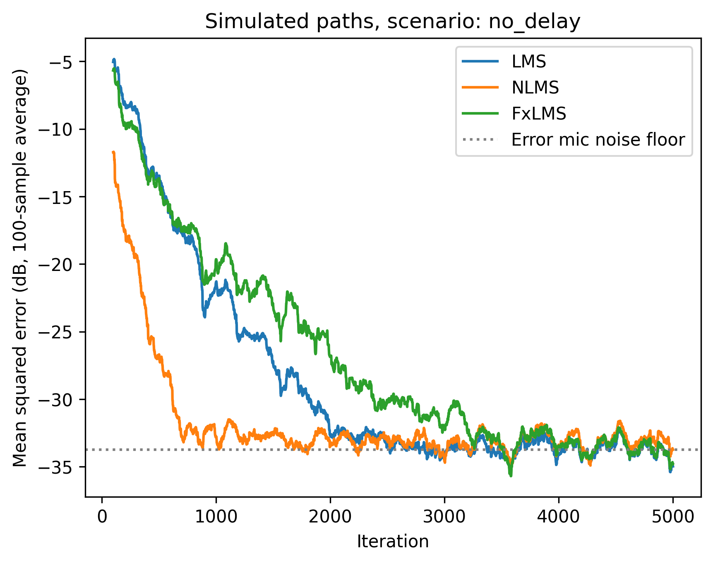

The convergence plot shows that NLMS reaches the defined threshold first, followed by LMS and FxLMS. These convergence times should not be interpreted as universal algorithm rankings, since each method uses its own step size.

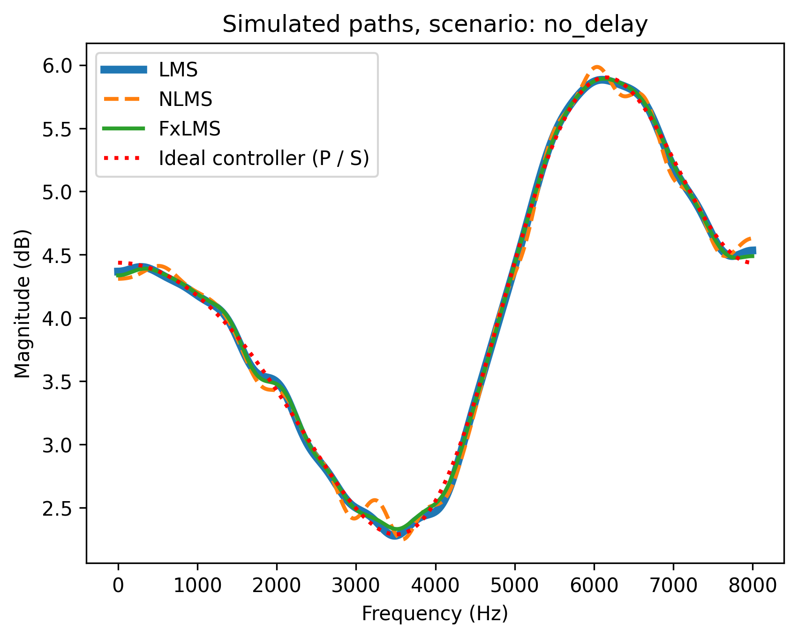

The frequency-response plot compares the controller weights learned by each algorithm with the ideal controller magnitude, `P(z)/S(z)`, where `P(z)` is the primary path and `S(z)` is the secondary path. All three algorithms are now trying to cancel noise through the same secondary path rather than learning different target systems.

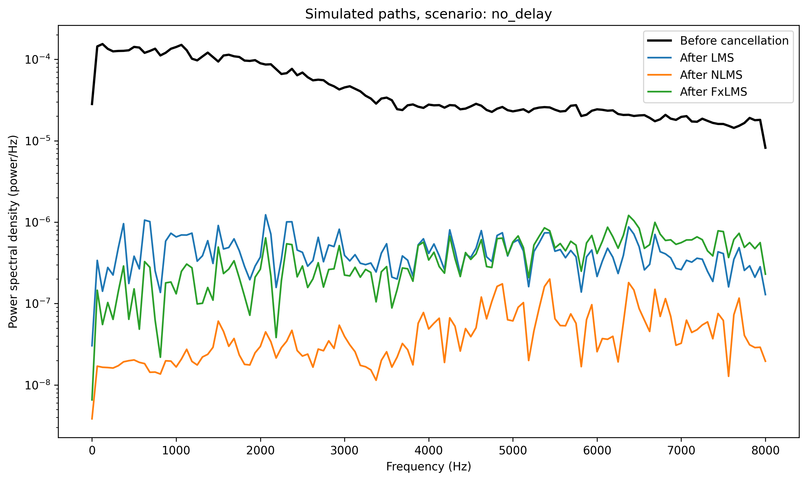

The power spectral density plot compares the original disturbance with the acoustic residual during adaptation. Its remaining peaks and notches depend on the filter weights learned in this particular run.

### Two-sample-delay scenario

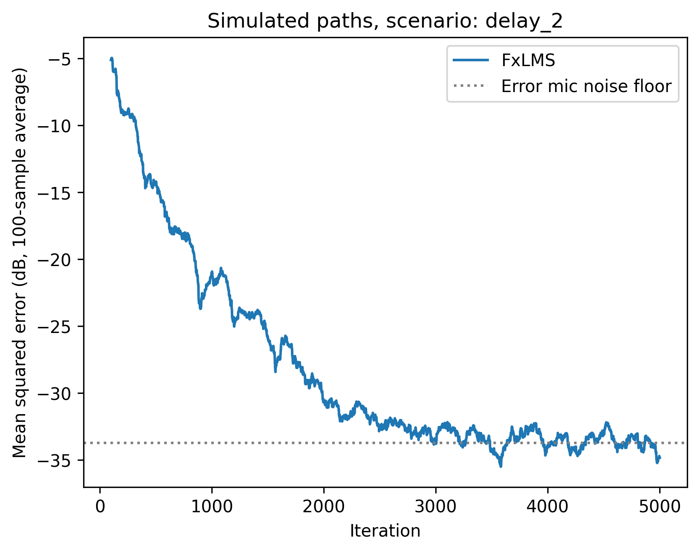

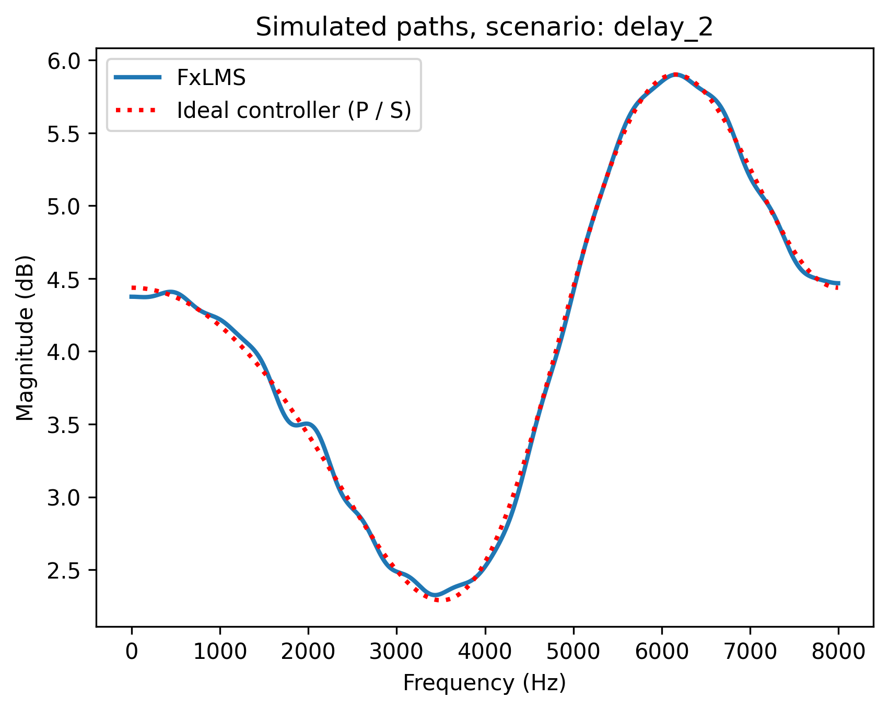

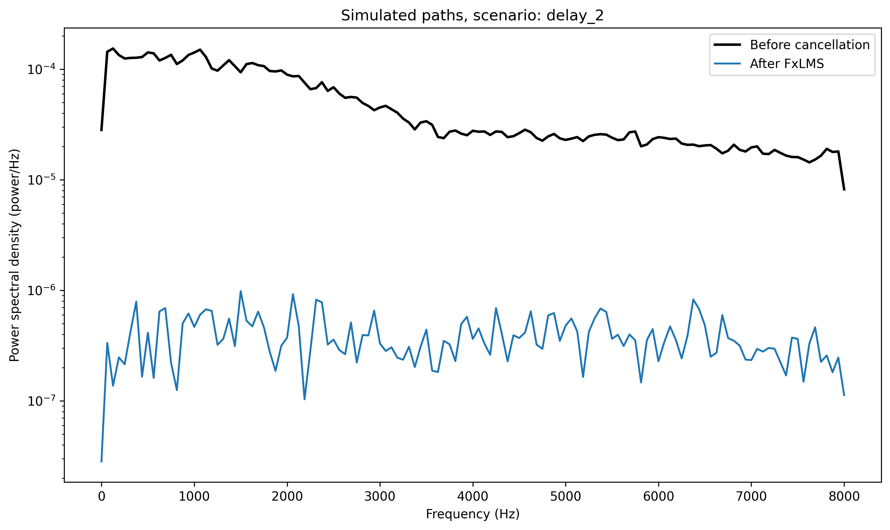

Only FxLMS is included in the saved baseline plots and audio for this scenario because LMS and NLMS are classified as diverged at their baseline step sizes.

### Four-sample-delay scenario

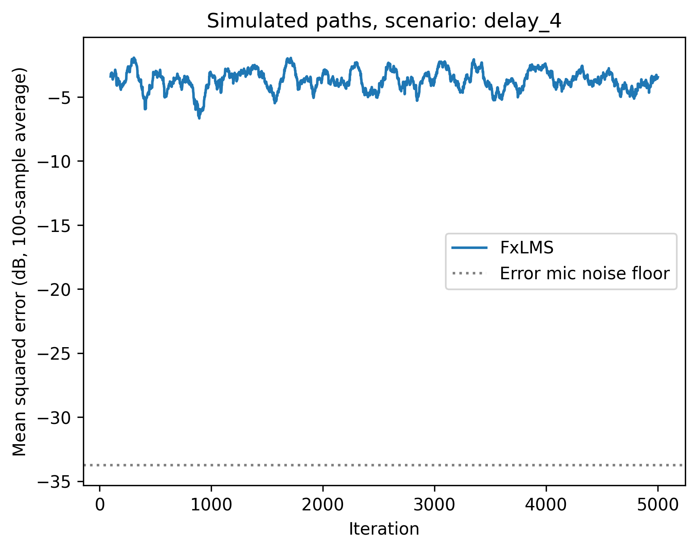

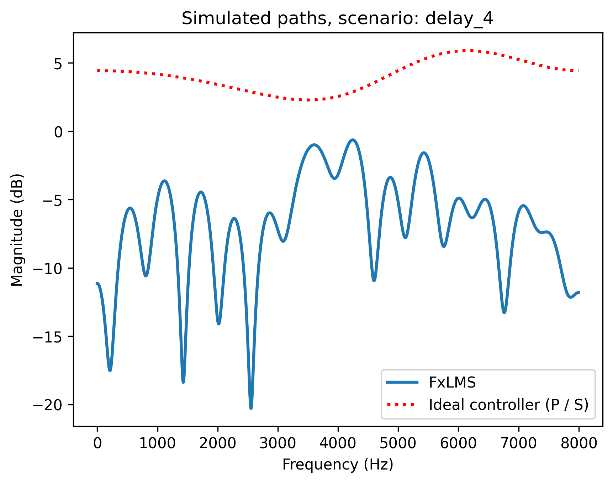

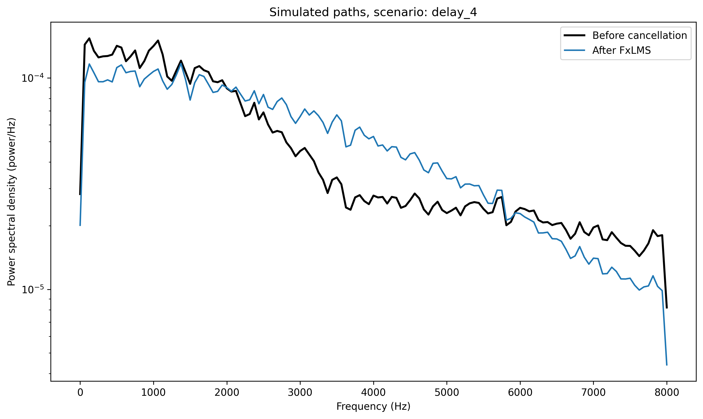

The near-zero reduction for FxLMS shows that a controller can remain stable without achieving useful cancellation. The longer secondary-path delay prevents the controller from acting early enough on this unpredictable noise source.

### Parameter sweep

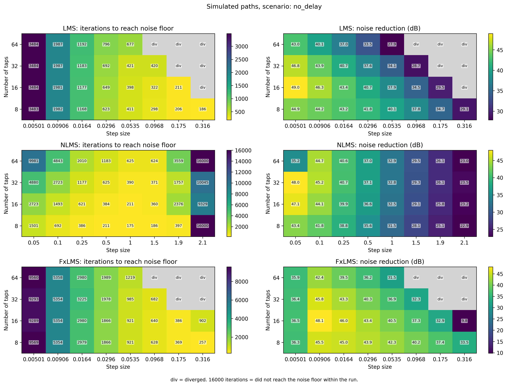

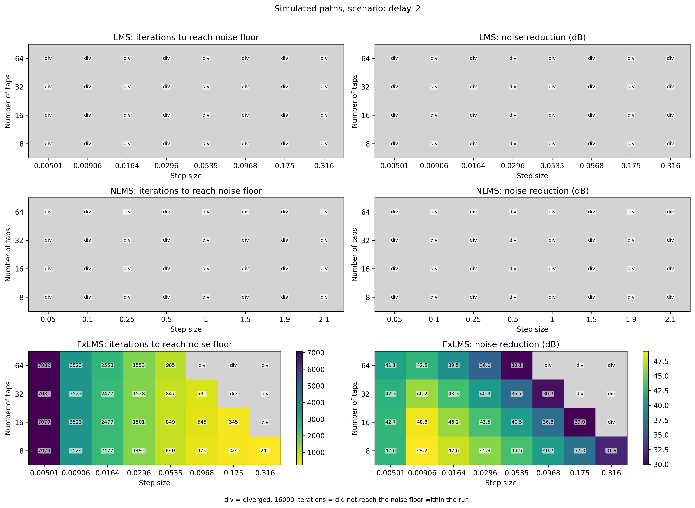

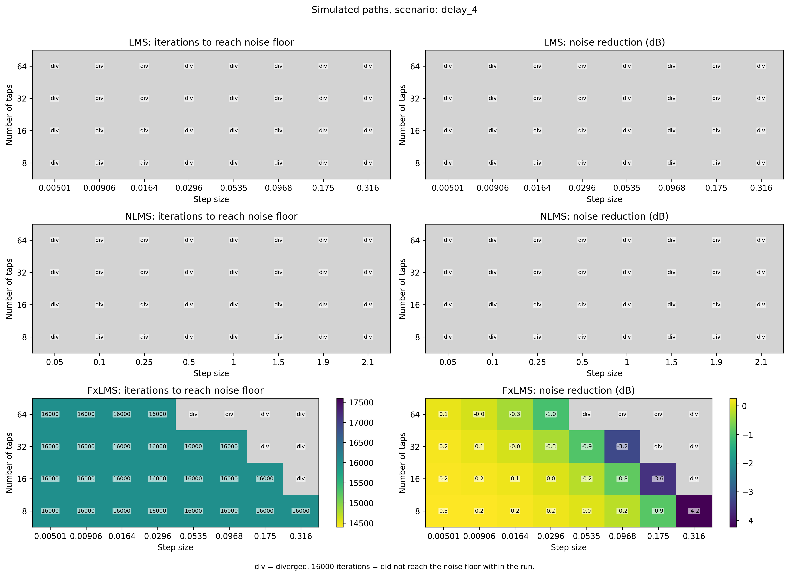

The parameter sweep tests how filter length and step size affect convergence and stability for each of the three secondary paths. It tests 8, 16, 32, and 64 taps, using algorithm-specific step-size grids. The reduction heatmaps now show results from the last 25% of the adaptive run, rather than results from applying final weights to the full signal.

A cell labeled 16000 indicates that the algorithm was not classified as diverged but did not reach the defined convergence threshold during the 16,000-sample run. It does not necessarily mean the algorithm was converging slowly at a constant rate; it may have reached a steady-state error above the threshold.

Gray cells labeled `div` indicate that the run diverged according to the simulation's stability criterion.

## Findings

### 1. Secondary-Path Delay Changes LMS and NLMS Stability

The biggest difference from my original simulation is that LMS and NLMS now have to send their cancelling signals through the secondary path, just like FxLMS. When this path has no leading delay, both algorithms reduce noise at their baseline step sizes. When the secondary path has a 2-sample delay, both are classified as diverged.

This shows that the stability of an adaptive filter depends on more than its step size and input power. In an ANC system, the timing and phase changes introduced by the secondary path affect the relationship between the update and the measured error.

### 2. Normalization Does Not Correct for the Secondary Path

NLMS normalizes the update by the reference signal energy, which can make step-size selection less sensitive to input amplitude and filter length. However, it still uses the raw reference for adaptation. The delay-2 result shows that normalization alone does not correct for the phase and delay introduced by the loudspeaker-to-microphone path.

The familiar `0 < μ < 2` rule applies to standard NLMS under particular assumptions and should not be treated as a general stability guarantee for this ANC loop.

### 3. LMS and NLMS Can Perform Differently Depending on the Acoustic Path

In the no-delay scenario, both LMS and NLMS achieve substantial noise reduction with the selected baseline parameters. NLMS reaches the convergence threshold faster, but LMS achieves a lower residual over the last quarter of the run.

These differences are not necessarily intrinsic advantages of either algorithm. Their step sizes are different, and the parameter sweeps show how performance changes with controller length and step size.

### 4. Filter Length and Step Size Still Affect Stability

The parameter sweeps continue to show that filter length and step size influence convergence and residual error. Longer filters have more coefficients to adapt, and a step size that works for one tap count may not be appropriate for another.

However, the stability limits from an ordinary LMS system-identification problem cannot simply be transferred to an ANC system with a secondary path. The path's gain, phase, and delay also need to be considered.

### 5. More Taps Do Not Necessarily Mean Better Cancellation

The primary path is only six taps long, so increasing the controller length does not automatically improve results. Extra coefficients can make adaptation more sensitive to noise or require a different step size.

The updated sweep evaluates the actual residual during adaptation, which is more useful for comparing real-time ANC behavior than measuring only how well the final filter would cancel a recording afterward.

### 6. FxLMS Accounts for Secondary-Path Delay

FxLMS filters the reference through an estimate of the secondary path before updating the weights. With the 2-sample secondary path, this allows it to converge while ordinary LMS and NLMS are classified as diverged at their baseline step sizes.

This is a useful demonstration of why FxLMS is designed for ANC: the controller must take the physical path from the loudspeaker to the error microphone into account when adapting.

### 7. Even FxLMS Cannot Overcome Every Acoustic Delay

When the secondary path has a 4-sample delay and the primary path has only a 2-sample delay, the cancelling signal cannot reach the error microphone before the unpredictable part of the disturbance. FxLMS remains numerically stable according to the chosen criterion but produces almost no reduction.

This demonstrates an important limitation of feedforward ANC. A perfect estimate of the secondary path is not enough if the controller does not have sufficient time to act. More predictable noise could produce different results.

## Conclusion

This simulation helped me better understand the difference between adaptive filtering in general and adaptive filtering specifically for active noise control.

LMS provides a straightforward way to update filter coefficients, but its performance depends heavily on the relationship between step size, input power, filter length, and the acoustic path. NLMS addresses some sensitivity to signal level by normalizing the coefficient updates, but it does not compensate for secondary-path delay. FxLMS adds another layer by accounting for the secondary path between the controller output and the error microphone.

The updated results also show that convergence speed, stability, and steady-state noise reduction are related but separate performance measures. A filter can converge quickly without reaching the lowest residual error, and a stable run can still fail to produce meaningful cancellation.

The loudspeaker, acoustic path, and error microphone are all part of the control system. Comparing the algorithms under the same conditions makes it clearer why FxLMS is better suited to delayed secondary paths, and why the timing of the noise and anti-noise can ultimately limit what an ANC system can achieve.

## Running the Simulation

The project uses `numpy`, `scipy`, `matplotlib`, `soundfile`, and `numba`. With `main.py` and `anc_core.py` in the `src/` folder, run:

```bash
python -m pip install numpy scipy matplotlib soundfile numba
python src/main.py
```

The script saves plots and WAV files under `output/no_delay/`, `output/delay_2/`, and `output/delay_4/`, with separate `plots/` and `audio/` folders in each. It also writes `output/scenario_summary.csv` containing baseline results for all scenarios. Set `RUN_PARAMETER_SWEEP = False` to skip the sweeps or `SHOW_PLOTS = True` to open plot windows. The shared adaptive loop is implemented in `anc_core.py`; it also supports FxNLMS, although the current experiment driver only compares LMS, NLMS, and FxLMS.
