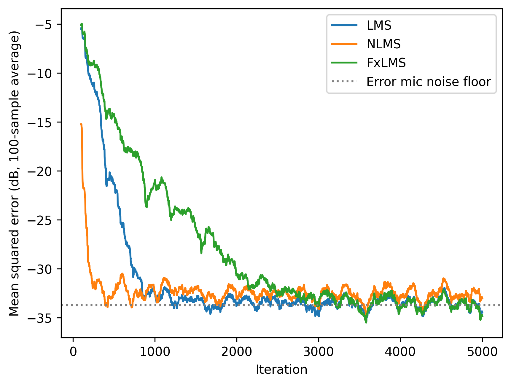
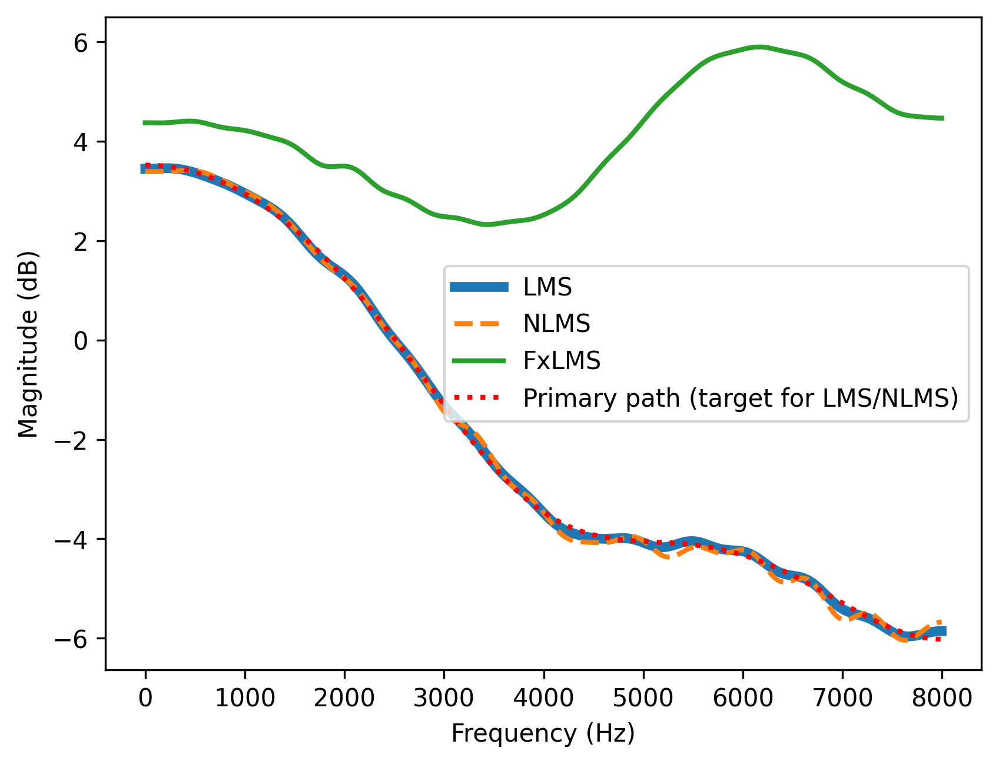
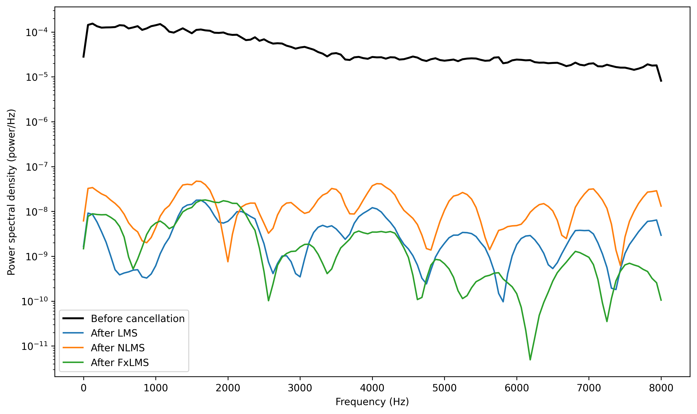
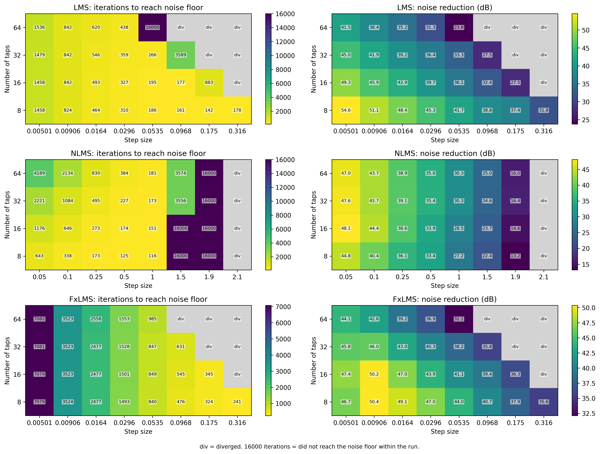

# Active Noise Control: LMS, NLMS, and FxLMS Simulation

A Python simulation exploring feedforward active noise control (ANC) by comparing three adaptive filtering algorithms: Least Mean Squares (LMS), Normalized Least Mean Squares (NLMS), and Filtered-x Least Mean Squares (FxLMS). The goal is to better understand how each algorithm adapts, how quickly it converges, how much noise it can reduce, and how changes in step size and filter length affect its stability.

## Overview

Active noise control works by generating a signal that is approximately equal in amplitude but opposite in phase to an unwanted sound. When the original noise and the anti-noise meet acoustically, they can partially or completely cancel each other out. In a feedforward ANC system, a reference microphone picks up the noise before it reaches the listening position. That signal is processed by an adaptive FIR filter, and the resulting anti-noise signal is played through a loudspeaker. An error microphone measures the remaining sound so the filter can adjust its coefficients.

One important part of ANC is that the signal coming from the loudspeaker does not reach the error microphone instantly. It passes through what is called the secondary path, which includes the loudspeaker, acoustic environment, and microphone response. This makes ANC more complicated than simply inverting the incoming noise signal.

This simulation models the reference noise, the primary path from the noise source to the error microphone, the secondary path from the loudspeaker to the error microphone, and sensor noise at the error microphone with a 30 dB signal-to-noise ratio (SNR).

## Signal Model

| Element | Value |
|---|---|
| Sample rate | 16 kHz, 1 second of signal |
| Noise | White Gaussian, reference variance 0.5 |
| Primary path | 6-tap FIR, 2-sample delay: [0, 0, 0.8, 0.4, 0.2, 0.1] |
| Secondary path | 5-tap FIR, 2-sample delay: [0, 0, 0.5, 0.3, 0.1] |
| Secondary path estimate | Exact copy of the secondary path |
| Error mic sensor noise | White, 30 dB below the noise at the mic |
| Controller length | 32 taps (baseline), 8 to 64 (sweep) |
| Random seed | 0 |

The paths are modeled as FIR filters, which is a useful way to represent the delays and amplitude changes that occur as sound travels through a system. The secondary path estimate is assumed to be perfect in this simulation. In a real ANC system, that path would normally have to be estimated, and errors in the estimate could affect how well the controller adapts.

**LMS (Least Mean Squares)**

LMS is an adaptive filtering algorithm that adjusts its filter coefficients based on the error between the desired signal and the current filter output. In this case, the algorithm uses the error microphone signal to determine how the filter should change.

`w(n+1) = w(n) + μ * e(n) * x(n)`

Here, `w(n)` represents the filter coefficients, `μ` is the step size, `e(n)` is the error signal, and `x(n)` is the reference input vector.

The step size controls how aggressively the filter updates. A larger step size can make the algorithm converge faster, but it can also cause the coefficients to fluctuate more or become unstable. A smaller step size usually produces smoother adaptation but takes longer to converge.

One thing I learned from testing LMS is that the step size cannot be chosen independently of the input signal and filter length. A value that works well for one configuration may cause another configuration to diverge.

**NLMS (Normalized Least Mean Squares)**

NLMS works similarly to LMS, but it normalizes the update using the energy of the input signal. This helps prevent the algorithm from making excessively large updates when the reference signal has a high amplitude.
    
`w(n+1) = w(n) + μ * e(n) * x(n) / (x(n)'x(n) + eps)`

The small value eps prevents division by zero or a very small number.

The main advantage of NLMS is that its step size is less dependent on the input signal level and filter length. For the standard NLMS update, the usual theoretical step-size range is 0 < mu < 2, although the actual behavior still depends on the assumptions of the system and the presence of noise.

This makes NLMS useful when the input level changes or when the same algorithm needs to work with different filter lengths.

**FxLMS (Filtered-x Least Mean Squares)**

FxLMS is designed specifically to account for the secondary path in an ANC system. This is an important difference from ordinary LMS because the controller output μst pass through the loudspeaker and acoustic path before it affects the error microphone.

`e(n) = d(n) - s * (w'x)(n)`

where d(n) is the noise reaching the error microphone through the primary path, y(n) is the controller output, and s(n) represents the secondary path. The asterisk represents convolution.

Because the secondary path changes the signal before it reaches the error microphone, FxLMS filters the reference signal through an estimate of that path before using it to update the controller coefficients:

`w(n+1) = w(n) + μ * e(n) * x_f(n),    x_f(n) = s_hat * x(n)`

The filtered reference gives the algorithm a better representation of how changes to the controller output will affect the measured error.

My main takeaway from looking at FxLMS is that the controller has to account for the actual signal path between the loudspeaker and the error microphone. Simply applying regular LMS to the same setup would ignore an important part of the system and would not give the correct gradient for minimizing the acoustic error.

## Evaluation Method

LMS and NLMS are evaluated as system-identification algorithms. In this part of the simulation, they learn the primary path between the reference signal and the error microphone signal. Their outputs are evaluated as if they reached the error microphone directly, without passing through a secondary path.

FxLMS is evaluated differently because its controller output passes through the modeled secondary path before reaching the error microphone.

This means the three algorithms are not being compared under exactly the same conditions. LMS and NLMS show how their adaptation rules behave when identifying the primary path, while FxLMS demonstrates how adaptation changes when the controller must account for the loudspeaker-to-microphone path. The comparison is useful for understanding the algorithms, but the noise-reduction values should not be treated as a direct, controlled ranking of which algorithm is best for ANC.

Noise reduction is calculated by applying each algorithm's final filter coefficients to the full signal and comparing the residual acoustic noise power with the original noise power. The error microphone's own sensor noise is excluded from this acoustic residual calculation.

This explains why the reported noise reduction can exceed the 30 dB SNR of the error microphone. The 30 dB value describes the microphone's measurement quality, not a hard limit on the amount of acoustic noise the controller can cancel. However, sensor noise still affects adaptation because the filter updates are based on the measured error signal, which contains that noise.

Convergence is defined as the first iteration where the 100-sample smoothed squared error comes within 3 dB of the sensor noise floor. A run is marked as diverged if its error becomes non-finite or finishes at a higher level than it started.

The 3 dB tolerance has a practical interpretation: it allows the smoothed error to be up to twice the noise-floor power. For the standard NLMS case, this corresponds to a misadjustment of 1, which occurs at a step size of `μ = 1`.

It is also important to distinguish convergence onset from settling time. The reported iteration count only measures when the smoothed error first enters the tolerance band. It does not guarantee that the error stays there afterward.

## Results

Baseline run (32 taps, 1 second at 16 kHz):

| Algorithm | Step size | Noise reduction (dB) | Iterations to noise floor |
|---|---|---|---|
| LMS | 0.01 | 41.4 | 735 |
| NLMS | 0.5 | 35.4 | 227 |
| FxLMS | 0.02 | 42.1 | 2,010 |

In this run, FxLMS produces the highest measured noise reduction at 42.1 dB, while NLMS converges to the defined noise-floor threshold the fastest at 227 iterations.

However, the 0.7 dB difference between LMS and FxLMS should not be interpreted as evidence that FxLMS is inherently better. The algorithms use different evaluation setups and different step sizes, and the results come from a single realization of white noise. The difference is also small enough that it could change with a different parameter choice or noise realization.

NLMS produces 35.4 dB of noise reduction in the baseline run. Its relatively large step size allows it to reach the threshold quickly, but it also produces a larger steady-state error. This is a common trade-off in adaptive filtering: faster adaptation can come at the cost of greater residual error.

The convergence plot shows that NLMS reaches the defined threshold first, followed by LMS and then FxLMS. All three reduce the error substantially, although NLMS settles approximately 1 dB above the sensor noise floor. This is consistent with the larger steady-state misadjustment expected from its baseline step size.

The frequency-response results also help explain what each algorithm is learning. LMS and NLMS converge toward the primary path, with a gain of approximately 3.5 dB at DC and -6 dB at Nyquist. This is consistent with their role as system-identification algorithms in this simulation.

FxLMS converges toward a different response because its goal is to cancel the noise after the controller signal passes through the secondary path. Ideally, the controller approximates the transfer-function ratio 
`P(z)/S(z)`, where `P(z)` is the primary path and `S(z)` is the secondary path.

Based on the path coefficients, this ratio has a gain of approximately 4.4 dB at both DC and Nyquist. That agrees with the FxLMS response shown in the plot.

The power spectral density plots show a substantial reduction in noise power across the frequency range for all three algorithms. The remaining spectral peaks and notches are related to the final filter coefficients obtained in this particular run. They should not be interpreted as intentional equalization or as a consistent feature of the algorithms.

NLMS has the highest residual noise in the baseline comparison, which is consistent with its larger step size and greater steady-state misadjustment.

### Parameter sweep

The parameter sweep tests how filter length and step size affect convergence and stability.

A cell labeled 16000 indicates that the algorithm remained stable but did not reach the defined convergence threshold during the 16,000-sample run. It does not necessarily mean the algorithm was converging slowly at a constant rate; it may have reached a steady-state error above the threshold.

Gray cells labeled div indicate that the run diverged according to the simulation's stability criterion.

## Findings

### 1. NLMS Step Size Affects Steady-State Error

For standard NLMS with white Gaussian input, the approximate misadjustment relation is:

`M ≈ μ / (2 - μ)`

Using the 30 dB microphone SNR as the reference, the predicted noise reductions are approximately:

| NLMS step size | Predicted noise reduction |
|---:|---:|
| 0.5 | 34.8 dB |
| 1.0 | 30.0 dB |
| 1.5 | 25.2 dB |

The parameter sweep produces approximately 35, 30, and 25 dB at these step sizes for a 32-tap controller. This is consistent with the theoretical relationship. Increasing the step size can speed up adaptation, but it also increases steady-state misadjustment.

### 2. The 3 dB Threshold Explains Some Stable NLMS Results

A step size of `μ = 1` gives a theoretical misadjustment of 1, meaning the steady-state error power is approximately twice the measurement noise-floor power. This is equivalent to 3 dB above the floor.

As a result, NLMS runs with step sizes of 1.5 and 1.9 can remain stable without meeting the simulation's convergence criterion. The μ = 2.1 run diverges, which agrees with the usual theoretical upper limit of 2 under standard assumptions.

### 3. LMS and NLMS Can Perform Similarly at Matched Convergence Times

At 32 taps, LMS with a step size of 0.0164 reaches the threshold in 546 iterations and produces 39.2 dB of noise reduction. NLMS with a step size of 0.25 reaches it in 495 iterations and produces 39.1 dB.

The similar results make sense because the reference is stationary white noise with a fixed variance of 0.5. Under these conditions, the NLMS normalization term is relatively consistent, so NLMS behaves approximately like LMS with a scaled step size:

`μ_effective ≈ μ_NLMS / (N × σ_x²)`

where:
- `μ_NLMS` is the NLMS step size.
- `N` is the filter length in taps.
- `σ_x²` is the reference signal variance.

The main advantage of NLMS in this simulation is that normalization makes step-size selection less sensitive to changes in input level and filter length.

### 4. LMS Stability Becomes More Restrictive as Filter Length Increases

For white input, an approximate mean-square stability limit for LMS is:

`μ_max ≈ 2 / (N × σ_x²)`

With a reference variance of 0.5, the approximate limits are 0.25 for 16 taps, 0.125 for 32 taps, and 0.0625 for 64 taps.

The parameter sweep brackets these limits reasonably well:

At 16 taps, LMS is stable at 0.175 and diverges at 0.316.
At 32 taps, LMS is stable at 0.0968 and diverges at 0.175.
At 64 taps, LMS is stable at 0.0535 and diverges at 0.0968.

The 8-tap configuration remains stable throughout the tested grid because the maximum step size of 0.316 is below its approximate theoretical limit of 0.5.

### 5. Additional LMS Taps Can Increase Residual Error

The primary path is only six taps long, so increasing the controller length beyond what is needed to model that path does not necessarily improve performance.

At a fixed LMS step size of 0.005, noise reduction falls from 54.6 dB with 8 taps to 41.5 dB with 64 taps. Additional coefficients can respond to gradient noise without providing much useful improvement to the model.

NLMS behaves differently because its normalized misadjustment is approximately independent of filter length to first order under the assumptions used here. At a step size of 0.05, its noise reduction stays relatively flat across 16 to 64 taps, ranging from 47.0 to 48.1 dB.

### 6. FxLMS Converges More Slowly in This Configuration

At 32 taps and a step size of 0.00906, LMS reaches the convergence threshold in 842 iterations, while FxLMS takes 3,523 iterations.

One possible reason is that the secondary path changes the amplitude and timing of the signal used for adaptation. The secondary path has a power gain of approximately 0.35, so the filtered reference has less power than the original reference. This reduces the effective adaptation rate for the same nominal step size.

The power difference explains part of the slower convergence, although it does not fully account for the observed factor of approximately four. The secondary path's delay and frequency response are also likely contributors, but their individual effects were not isolated in this simulation.

### 7. The FxLMS Stability Boundary Is Similar to the LMS Boundary in the Sweep

The FxLMS stability boundary falls within the same tested step-size interval as LMS for each filter length, even though the filtered reference has lower power.

This suggests that the secondary path affects more than signal amplitude. Its delay and frequency response also change the relationship between the controller coefficients and the measured error. Since the parameter sweep is relatively coarse, a more detailed sweep would be needed to estimate the stability boundaries precisely.

## Conclusion

This simulation helped me better understand the difference between adaptive filtering in general and adaptive filtering specifically for active noise control.

LMS provides a straightforward way to learn a system response, but its performance depends heavily on the relationship between step size, input power, and filter length. NLMS addresses some of that sensitivity by normalizing the coefficient updates, making it easier to work with different signal levels and controller lengths. FxLMS adds another layer by accounting for the secondary path between the controller output and the error microphone.

The results also show that convergence speed, stability, and steady-state noise reduction are related but separate performance measures. A filter can converge quickly without reaching the lowest residual error, and a stable run can still fail to reach a chosen convergence threshold.

The loudspeaker, acoustic path, and error microphone are all part of the control system. FxLMS is designed to account for that relationship, which makes it a more appropriate algorithm for the modeled feedforward ANC configuration, even though its adaptation can be slower and more sensitive to the details of the secondary path.
